  

**MSc student in Economics and International Business at South Ural State University.** I build software tools that people can run and check: retrieval-based assistants, browser extensions and web apps.

## Background and interests
- Economics and international business, with a focus on how information and prices reach decision makers.
- Retrieval-augmented generation for universities: answers grounded in official documents, with citations and a refusal when retrieval is weak.
- Browser tooling that keeps user data local.

## Selected projects
- **[ragbot](https://github.com/dev-kleo/ragbot)**: RAG platform for university documents. FastAPI, PostgreSQL + pgvector, bge-m3 embeddings, local LLM via Ollama, page-level citations.
- **[Uniassist](https://github.com/dev-kleo/Uniassist)**: platform that brings academics, resources and campus needs into one place for students.
- **[price-tracker](https://github.com/dev-kleo/price-tracker)**: Chrome extension (MV3) tracking prices on Ozon, Wildberries and Yandex Market. Local-only data, 150+ automated browser tests.
- **[OpenHighlights](https://github.com/dev-kleo/InkMind)**: Chrome extension for highlighting web pages.

## Stack

## Contact
[deyintelligence.com](https://deyintelligence.com) · [hello.deyabhishek@gmail.com](mailto:hello.deyabhishek@gmail.com)
